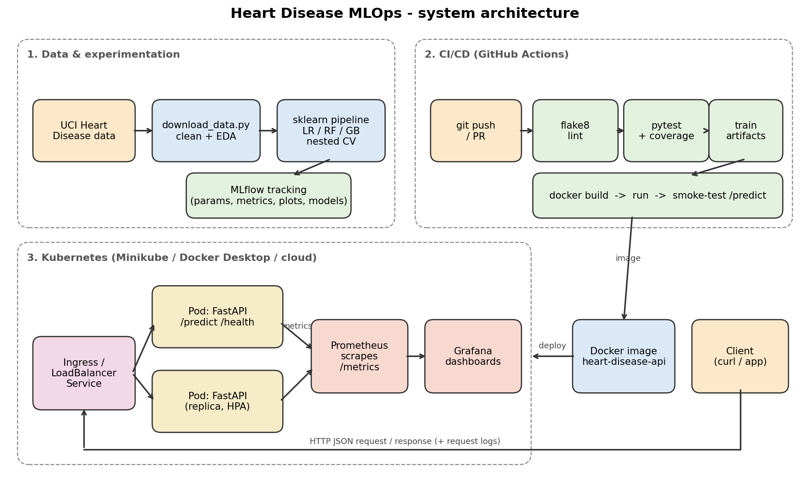

# Heart Disease Risk Prediction - End-to-End MLOps

Reproducible ML pipeline for predicting heart disease (UCI Cleveland data): EDA -> tuned models with MLflow
tracking -> packaged sklearn pipeline -> pytest + GitHub Actions CI/CD -> Dockerised FastAPI -> Kubernetes ->
Prometheus/Grafana monitoring.



## Quick start
```bash
python -m venv .venv && source .venv/bin/activate
pip install -r requirements.txt
make data eda train        # or the python commands in the Makefile
make test lint
make serve                 # http://localhost:8000/docs
```

## Repository layout
| Path | Purpose |
|---|---|
| `scripts/download_data.py` | download + clean the dataset |
| `src/` | `data`, `features`, `modeling`, `eda`, `train` (MLflow), `predict`, `api` (FastAPI) |
| `notebooks/` | EDA, training, inference notebooks |
| `tests/` | pytest unit tests (data, features, modelling, API) |
| `.github/workflows/ci.yml` | lint -> test -> train -> docker smoke test |
| `Dockerfile`, `requirements*.txt` | container + pinned dependencies |
| `k8s/` | Deployment, Service (LoadBalancer), Ingress, HPA, in-cluster monitoring |
| `monitoring/` | docker-compose Prometheus + Grafana with provisioned dashboard |
| `models/` | `model.joblib` (full pipeline) + `model_info.json` |
| `docs/REPORT.md` | final report; `screenshots/` evidence |

## API
`POST /predict` with `sample_input.json` ->
```json
{"prediction": 1, "label": "heart disease likely", "confidence": 0.87, "probability_disease": 0.87,
 "risk_level": "high", "model_version": "...", "request_id": "..."}
```
Other endpoints: `/health`, `/model-info`, `/metrics`, `/docs`.

## Docker
```bash
docker build -t heart-disease-api:1.0.0 .
docker run --rm -p 8000:8000 heart-disease-api:1.0.0
bash scripts/smoke_test.sh
```

## Kubernetes (Minikube)
```bash
minikube start && minikube image load heart-disease-api:1.0.0
kubectl apply -f k8s/deployment.yaml -f k8s/service.yaml
minikube tunnel                      # new terminal; then: kubectl get svc heart-disease-api
```
Optional: `minikube addons enable ingress metrics-server` then apply `ingress.yaml`, `hpa.yaml`;
monitoring: `kubectl apply -f k8s/monitoring.yaml` (+ `kubectl port-forward svc/grafana 3000:3000`).

## Monitoring (local)
`docker compose -f monitoring/docker-compose.yml up --build`, then
`python scripts/generate_traffic.py`. Prometheus: :9090, Grafana: :3000 (admin/admin).
