# Heart Disease Risk Prediction - End-to-End MLOps Pipeline
**MLOps (AIMLCZG523) - Assignment 01**

**Name:** Isha Singh | **BITS ID:** 2025AE05818 | **Email:** 2025ae05818@wilp.bits-pilani.ac.in

**Code repository:** https://github.com/Isha-K777/heart-disease-mlops

**Deployed API / access instructions:** Docker Desktop Kubernetes. Run `kubectl apply -f k8s/deployment.yaml -f k8s/service.yaml`, then open `http://localhost/docs`

**Demo video:** 

# 1. Problem statement and overview

The goal is to predict whether a patient has heart disease from 13 clinical attributes
(UCI Heart Disease - Cleveland subset) and to ship the model as a reproducible, tested,
containerised, monitored service. The project covers the full lifecycle: data acquisition,
EDA, modelling with experiment tracking, packaging, CI/CD, Docker, Kubernetes deployment and
monitoring.

**Key results (summary)**

| Item | Value |
|---|---|
| Selected model | logistic_regression |
| Nested-CV ROC-AUC | 0.898 ± 0.014 |
| Held-out test ROC-AUC / Recall | 0.964 |
| Unit tests / coverage | 24 tests, all passing; 69% line coverage of src/ |
| Deployment target | Local Kubernetes (Docker Desktop): 2-replica Deployment, LoadBalancer Service, monitored with in-cluster Prometheus and Grafana |

# 2. Setup and installation

```bash
git clone https://github.com/Isha-K777/heart-disease-mlops.git && cd heart-disease-mlops
python -m venv .venv && source .venv/bin/activate      # Windows: .venv\Scripts\activate
pip install -r requirements.txt
python scripts/download_data.py          # downloads + cleans the UCI data
python -m src.eda                        # figures -> reports/figures/
python -m src.train                      # trains 3 models, logs to MLflow, saves models/model.joblib
pytest                                   # unit tests
mlflow ui --backend-store-uri ./mlruns   # http://localhost:5000
uvicorn src.api:app --port 8000          # http://localhost:8000/docs
```

Docker: `docker build -t heart-disease-api:1.0.0 .` then `docker run -p 8000:8000 heart-disease-api:1.0.0`
and `bash scripts/smoke_test.sh`.  Python 3.11; all versions pinned in `requirements.txt`.

# 3. Data acquisition and cleaning

* **Source:** UCI ML Repository, Heart Disease dataset (Cleveland). `scripts/download_data.py` downloads
  `processed.cleveland.data` (with a `ucimlrepo` fallback) and writes `data/raw/heart_disease_raw.csv`
  and `data/processed/heart_clean.csv`.
* **Size:** 303*14, 13 features + target.
* **Target:** original `num` (0-4 severity) is binarised: `target = (num > 0)`.
* **Missing values:** 4 in `ca`, 2 in `thal` encoded as `?`. They are kept as NaN in the cleaned CSV
  and imputed *inside* the pipeline (median for numeric, mode for categorical), so imputation statistics are
  learnt only from training folds - no leakage.
* **Other cleaning:** type coercion to float64, exact-duplicate removal, schema validation.

# 4. Exploratory data analysis

Figures are generated by `src/eda.py` (and `notebooks/01_eda.ipynb`).

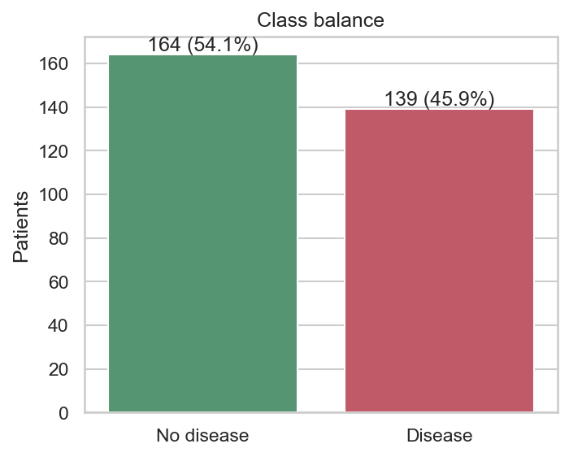

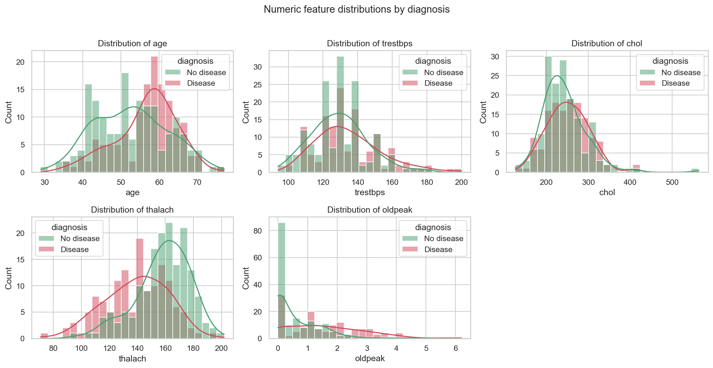

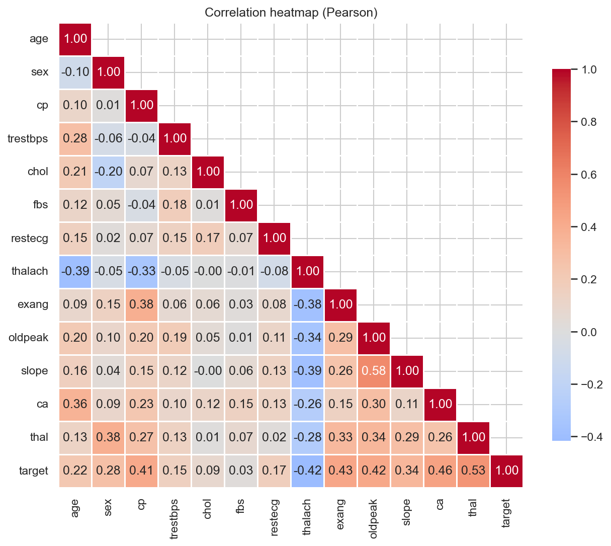

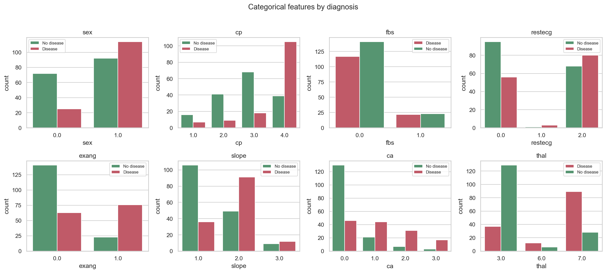

**Observations** 

`Data quality and class balance`
The dataset has 303 patients: 164 without heart disease (54.1%) and 139 with it (45.9%). The classes are nearly balanced, so no resampling is needed and accuracy is a meaningful metric. I still use a stratified split and prioritise recall and ROC-AUC, because missing a sick patient is costlier than a false alarm.
Only two columns have missing values: ca (4 rows) and thal (2 rows), about 2% of patients. They are too few to justify dropping rows, so they are imputed inside the pipeline (median or most-frequent) to avoid leakage.

`Numeric features`
thalach (max heart rate) separates the classes well. Patients with disease peak around 145 bpm, healthy patients around 160 to 165, and the boxplot medians are about 142 vs 161.
oldpeak (ST depression) is strongly right-skewed. Most healthy patients sit at or near 0 (about 85 patients in the first bin), while the disease group has a median of about 1.4 and a long tail up to about 6.
age is higher in the disease group (median about 58 vs 52), and disease cases cluster around 55 to 65.
trestbps (resting blood pressure) and chol (cholesterol) overlap heavily between classes with almost identical medians (about 130 and about 235 to 250). They are weak individual predictors.

`Outliers`
The boxplots show a few extreme points: one chol value above 550, trestbps near 200, oldpeak above 5.5, and one very low thalach (about 70). These are medically possible values and not data-entry errors, so I kept them. StandardScaler and tree-based models handle them reasonably.

`Categorical features`
Chest pain type cp = 4 (asymptomatic) is the strongest category: about 105 of roughly 145 patients with this value have disease. Types 1 to 3 are mostly healthy.
Exercise-induced angina (exang = 1) is mostly disease (about 76 vs 22), and exang = 0 is mostly healthy.
thal = 7 (reversible defect) is mostly disease (about 89 vs 28), while thal = 3 (normal) is mostly healthy (about 129 vs 37).
For ca (vessels coloured), 0 vessels is mostly healthy (about 130 vs 46), and 1 or more vessels shifts toward disease.
The slope of the ST segment follows the pattern too: slope = 2 is mostly disease (about 91 vs 49) and slope = 1 is mostly healthy (about 106 vs 36).
Males (sex = 1) have a much higher disease share (about 55%) than females (about 26%).
fbs shows almost no separation, and restecg = 1 has only a handful of patients.

`Correlations`
The features most correlated with the target are thal (0.53), ca (0.46), exang (0.43), oldpeak (0.42) and cp (0.41). thalach is the strongest negative one (−0.42). fbs (0.03) and chol (0.09) are nearly uncorrelated with the target.
The highest correlation between two features is slope vs oldpeak (0.58). No pair exceeds 0.6, so there is no serious multicollinearity, and logistic regression is safe to use.

`Implications for modelling`
These findings led me to one-hot encode the categorical features (their codes are labels, not quantities), scale the numeric ones, and add a hr_reserve_pct feature that compares max heart rate to the age-predicted maximum, because thalach and age are both informative and correlated (−0.39).

* Class balance: 54% positive - roughly balanced, so accuracy is meaningful but recall is still prioritised
  because a missed diagnosis is costlier than a false alarm.
* Features most correlated with target: thal (0.53), ca (0.46), exang (0.43), oldpeak (0.42) and cp (0.41).
* Outliers: chol > 500, oldpeak > 5, trestbps > 200 - kept (clinically plausible), scaled with StandardScaler.
* Which categorical values separate classes most (cp = 4, exang = 1, thal = 7 ...): thal.

# 5. Feature engineering and modelling

## 5.1 Preprocessing pipeline (`src/features.py`)

| Step | Details |
|---|---|
| ClinicalFeatures (custom transformer) | hr_reserve_pct = thalach / (220 - age), chol_per_age = chol / age |
| Numeric branch | median imputation -> StandardScaler |
| Categorical branch | most-frequent imputation -> OneHotEncoder(`handle_unknown="ignore"`) |

The preprocessing is part of one `sklearn.Pipeline` with the classifier, so training and serving apply
*identical* transformations and the whole object is serialised as a single artefact.

## 5.2 Models and tuning

Three classifiers were compared (`src/modeling.py`):

| Model | Why | Grid searched |
|---|---|---|
| Logistic Regression | interpretable baseline | C in {0.01, 0.1, 1, 10}, class_weight in {None, balanced} |
| Random Forest | non-linear, robust to scale | n_estimators {200, 400}, max_depth {None, 5, 10}, min_samples_leaf {1, 3, 5} |
| Gradient Boosting | strong tabular learner | n_estimators {100, 200}, learning_rate {0.03, 0.1}, max_depth {2, 3} |

**Protocol.** 80/20 stratified train/test split (seed 42). On the training set, hyper-parameters are tuned with
3-fold GridSearchCV optimising ROC-AUC. To avoid optimistic bias the tuned model is evaluated with **nested
cross-validation** (5 outer folds x 3 inner folds). The untouched 20% test set is used once per model for the
final report. The model with the highest nested-CV ROC-AUC is selected.

## 5.3 Results

| Model | CV Acc | CV Prec | CV Rec | CV F1 | CV ROC-AUC | Test ROC-AUC |
|---|---|---|---|---|---|---|
| logistic_regression **(selected)** | 0.831 ± 0.016  | 0.859 ± 0.067  | 0.765 ± 0.055  | 0.805 ± 0.015  | 0.898 ± 0.014 | 0.964 |
| random_forest | 0.806 ± 0.010  | 0.824 ± 0.054  | 0.747 ± 0.086  | 0.777 ± 0.026  | 0.886 ± 0.033 | 0.958 |
| gradient_boosting | 0.806 ± 0.035  | 0.814 ± 0.077  | 0.765 ± 0.080  | 0.782 ± 0.037  | 0.874 ± 0.029 | 0.950 |


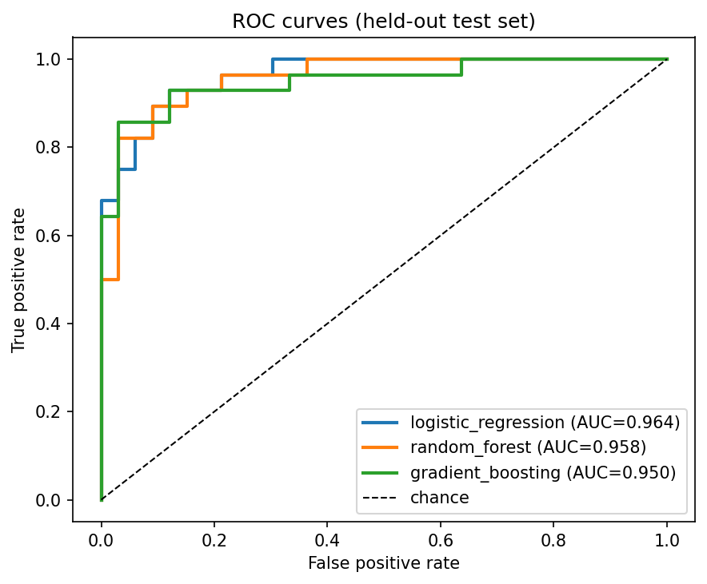

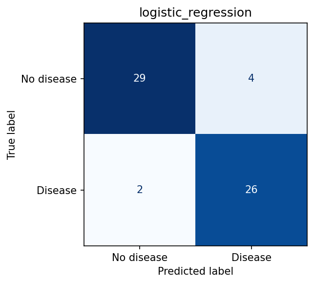

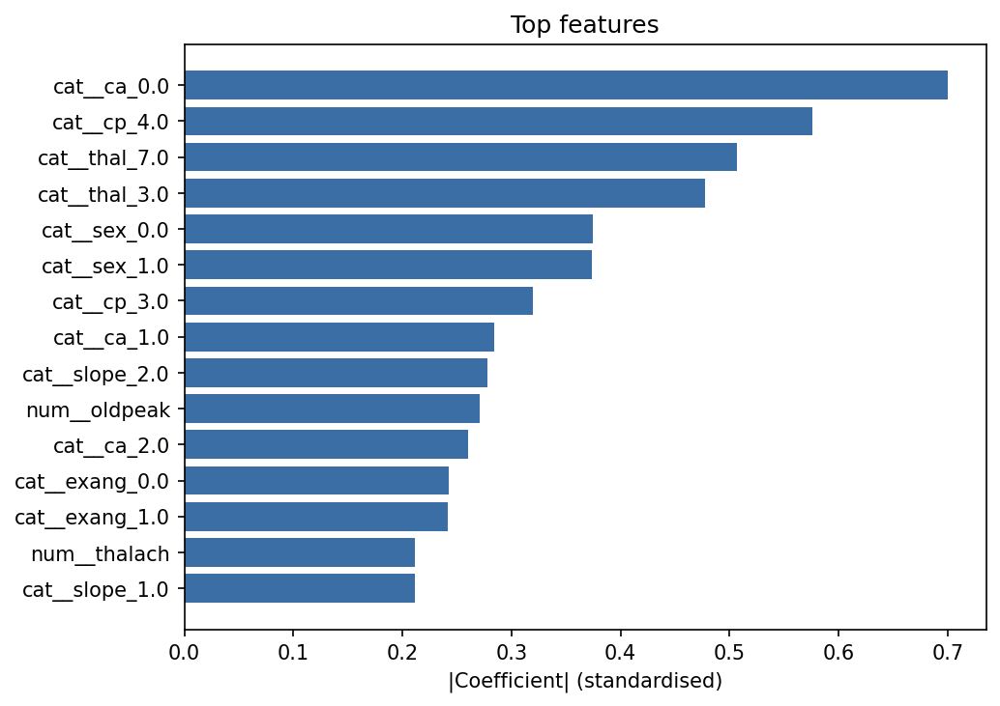

**Discussion** 

All three models performed well, with nested-CV ROC-AUC between 0.874 and 0.898. Logistic regression had the highest score on every headline metric (accuracy 0.831, precision 0.859, ROC-AUC 0.898) and the lowest variance in ROC-AUC (±0.014), so it was selected. The differences between models are small, though. The gap between logistic regression (0.898) and random forest (0.886) is less than one standard deviation of either, so I can’t claim it is a statistically meaningful win. I chose logistic regression because it is as good as or better than the alternatives on every metric, is the simplest and most interpretable, trains and serves fastest, and its coefficients can be explained to clinicians.

`Why the simple model won?` The dataset is small (303 patients), and the EDA showed that many features separate the classes in a roughly linear way (for example thal, ca, exang, oldpeak, thalach). With so few samples, flexible models like random forest and gradient boosting have little extra signal to learn and can overfit, which is a typical result on small tabular medical data.

`Cross-validation vs held-out test` The test ROC-AUC (0.964) is higher than the nested-CV estimate (0.898). The test set holds only about 61 patients, so a single split is noisy and this particular split was probably favourable. I consider the nested-CV figure the more reliable estimate of real performance, and I used the test set only once per model for a final check, not for selection. The test ranking (LR > RF > GB) matches the CV ranking, which supports the choice.

`Precision vs recall` The selected model has precision 0.859 and recall 0.765. In a screening setting a missed patient (false negative) is costlier than a false alarm, so recall matters more. At the default 0.5 threshold, roughly 1 in 4 sick patients is missed in cross-validation. In production the decision threshold could be lowered (for example to 0.35 to 0.4) to raise recall at the cost of precision, and the API’s probability_disease and risk_level fields already allow this.

`Best hyperparameters` The grid search chose C = 0.1 and class_weight = none.

`Limitations` The data comes from one hospital (Cleveland) with only 303 patients, there is no external validation, and the metrics are not calibrated against real clinical outcomes. The model is a demonstration of the MLOps pipeline and not a diagnostic tool.

# 6. Experiment tracking (MLflow)

Each model is one MLflow run in experiment heart-disease-risk, plus a model_selection run. Logged items:

* **Parameters:** model name, split sizes, CV folds, seed, best hyper-parameters, grid size, sklearn version.
* **Metrics:** nested-CV mean/std of accuracy, precision, recall, F1, ROC-AUC; held-out test metrics.
* **Artifacts:** ROC curve, confusion matrix, feature-importance plot, grid-search table (CSV), the fitted
  pipeline as an MLflow model with signature, `requirements.txt`, `model_info.json`.

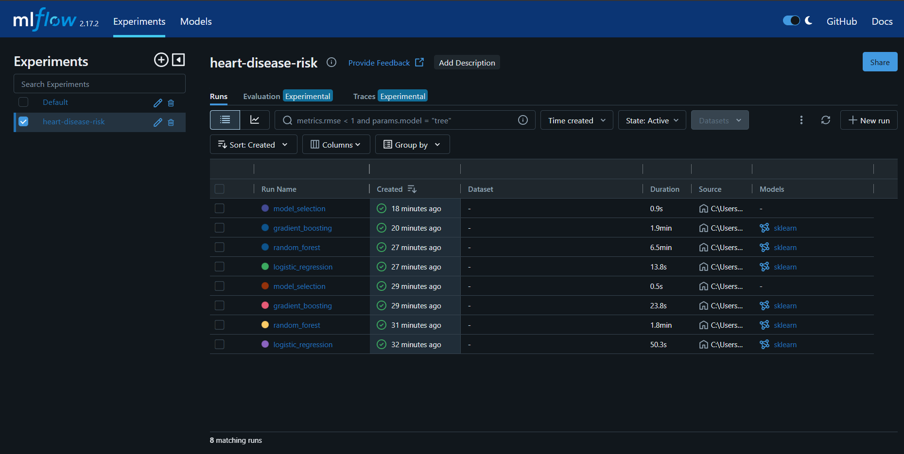
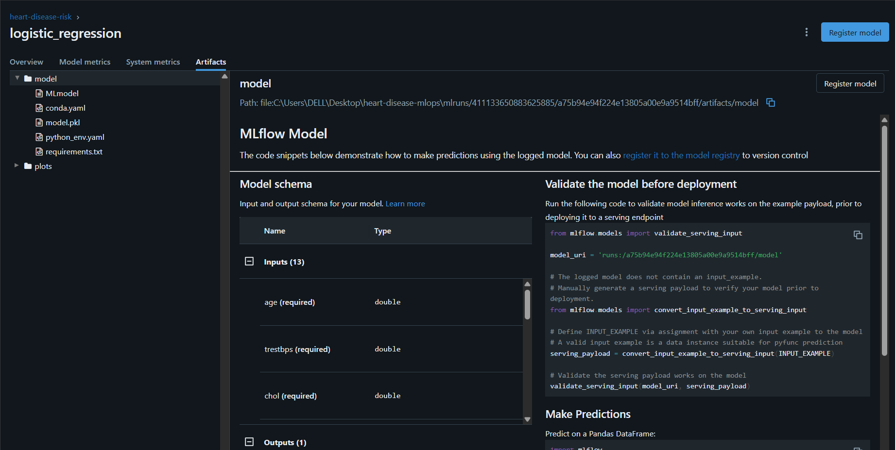

# 7. Model packaging and reproducibility

* Final model: `models/model.joblib` (full pipeline) + `models/model_info.json` (version, metrics, features); also
  logged as an MLflow model (`mlflow.sklearn`) for registry-style loading.
* `requirements.txt` (full) and `requirements-api.txt` (slim serving image) pin exact versions.
* Fixed random seed (42) everywhere; deterministic split; scripts run from a clean environment
  (`pip install -r requirements.txt && make all`).
* Inference path (`src/predict.py`, `src/api.py`) re-uses the same pipeline object - no re-implemented preprocessing.

# 8. CI/CD pipeline (GitHub Actions)

Workflow: `.github/workflows/ci.yml`

| Job | Purpose | Fails the pipeline when |
|---|---|---|
| `lint` | flake8 | any style/syntax error |
| `test` | pytest + coverage, uploads XML reports | any test fails |
| `train` | download data, EDA, train + MLflow, uploads model/mlruns/plots as artifacts, writes metric table to job summary | training errors |
| `docker` | build image, start container, wait for `/health`, run `/predict` smoke test, upload container log | container does not build/serve |

Jobs are chained with `needs: so a failure stops everything downstream and the logs show the failing step.

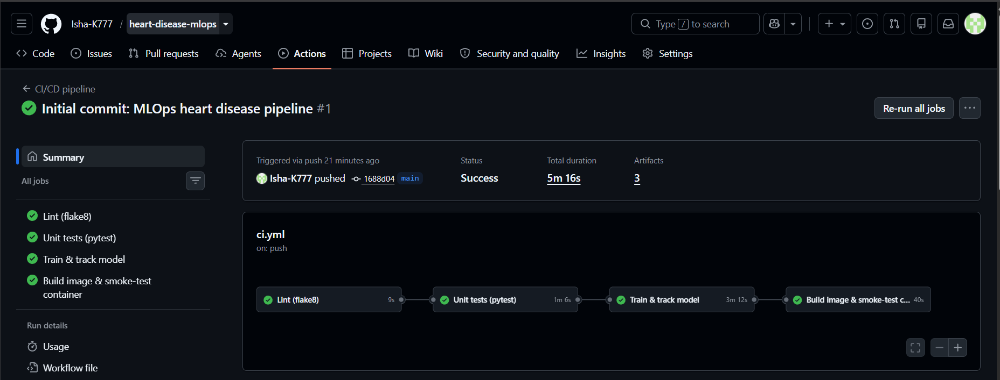
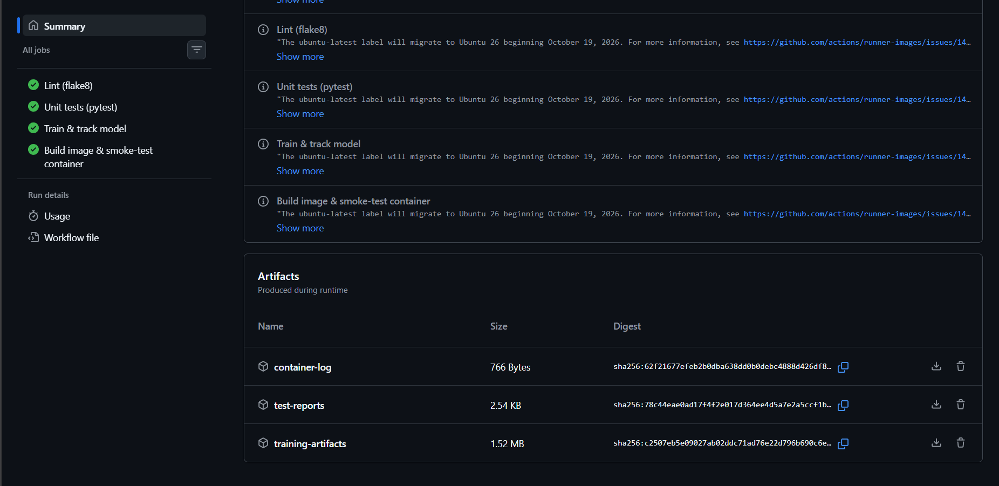
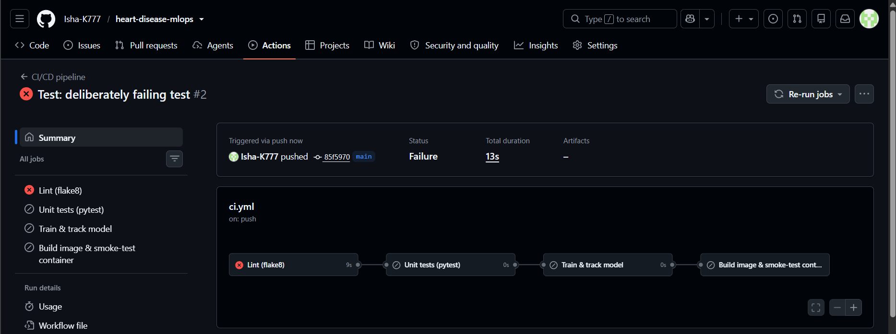

# 9. Containerisation

`Dockerfile`: python:3.11-slim, slim dependency file, non-root user, `HEALTHCHECK`, uvicorn entrypoint.

**API contract**

| Endpoint | Description |
|---|---|
| `POST /predict` | JSON patient features -> `prediction`, `label`, `confidence`, `probability_disease`, `risk_level`, `model_version`, `request_id` |
| `GET /health` | readiness/liveness (503 if model not loaded) |
| `GET /model-info` | model metadata |
| `GET /metrics` | Prometheus metrics |
| `GET /docs` | Swagger UI |

Input is validated with Pydantic (ranges, types); invalid input returns HTTP 422.

```bash
curl -X POST localhost:8000/predict -H "Content-Type: application/json" -d @sample_input.json
```
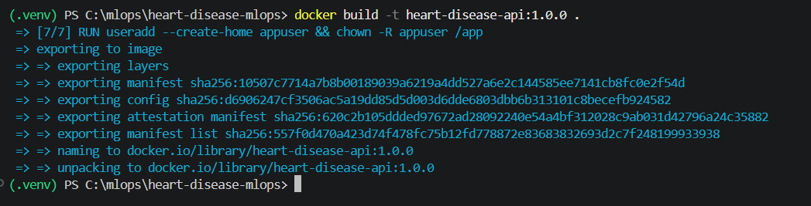
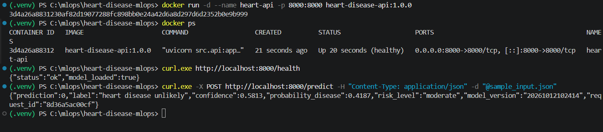
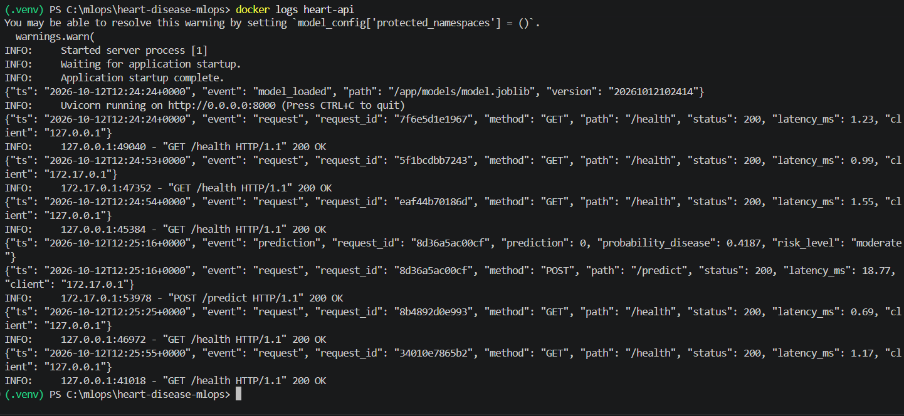
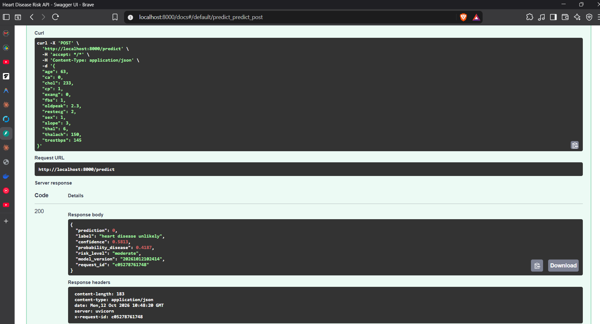

# 10. Kubernetes deployment

Manifests in `k8s/`: `deployment.yaml` (2 replicas, rolling update, probes, resource limits),
`service.yaml` (LoadBalancer), `ingress.yaml` (nginx), `hpa.yaml` (CPU autoscaling), `monitoring.yaml`.

```bash
minikube start
minikube image load heart-disease-api:1.0.0       # Docker Desktop: skip
kubectl apply -f k8s/deployment.yaml -f k8s/service.yaml
minikube tunnel                                   # separate terminal -> EXTERNAL-IP
kubectl get pods,svc
curl http://<EXTERNAL-IP>/health
```

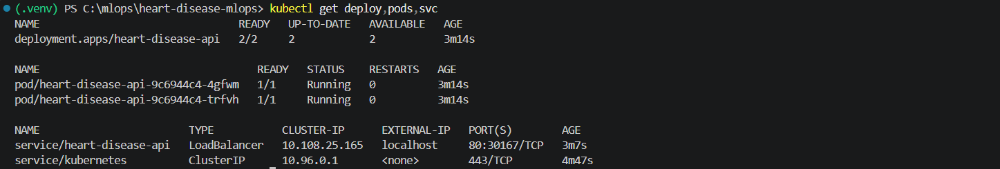
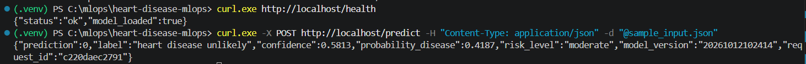
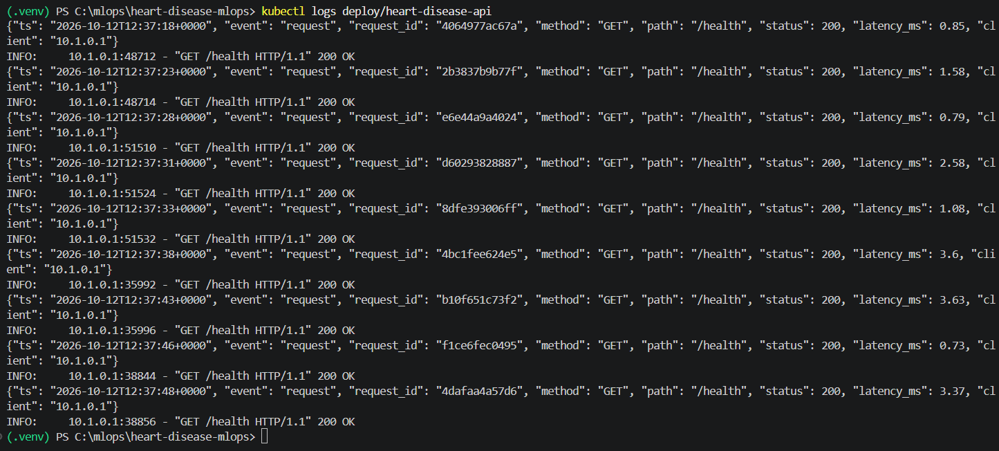

# 11. Monitoring and logging

* **Structured JSON logs** for every request (request id, method, path, status, latency, client) and every
  prediction (class, probability, risk level). `kubectl logs` / `docker logs` show them.
* **Prometheus metrics:** `http_requests_total`, `http_request_duration_seconds`, `predictions_total`,
  `prediction_confidence`, `prediction_probability_disease`, `http_requests_in_progress`, `model_loaded`.
* **Grafana dashboard** (`monitoring/grafana/dashboards/heart-api.json`, auto-provisioned): request rate, p95 latency,
  predictions by class, error rate, average confidence, model-loaded status.
* Traffic for the demo: `python scripts/generate_traffic.py --n 300`.

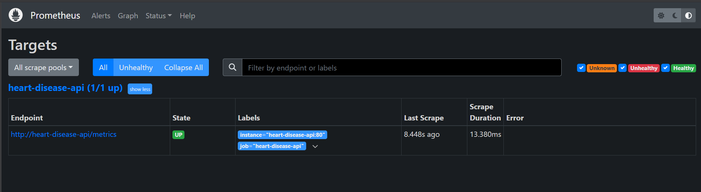
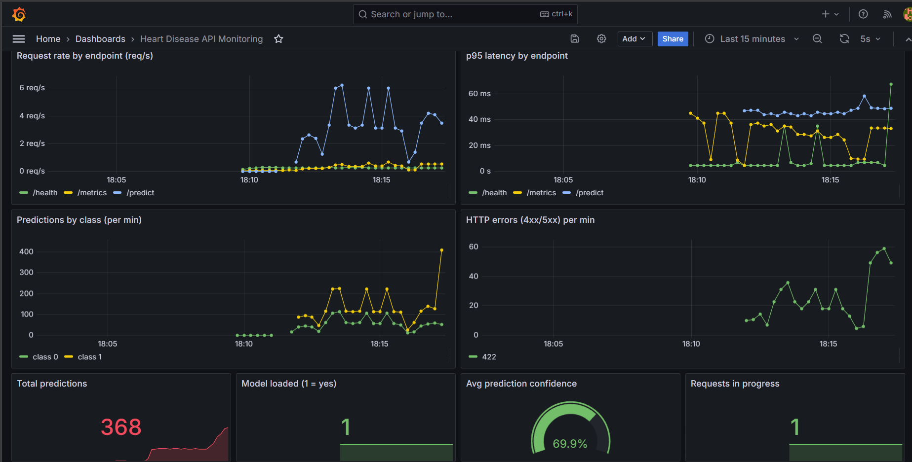

# 12. Architecture


The system is organised into three stages, shown in the diagram above. In the experimentation stage, a download script fetches the UCI Heart Disease data and cleans it. EDA and model training then run against the cleaned data. Training builds a single scikit-learn pipeline (feature engineering, preprocessing and classifier) for three candidate models, tunes them with nested cross-validation, and logs every run (parameters, metrics, plots and the model itself) to MLflow. The best model is saved as one model.joblib file together with a metadata file, so serving uses exactly the same preprocessing as training. In the CI/CD stage, every push to GitHub triggers a GitHub Actions workflow that runs flake8 linting, then the pytest suite, then a training job that stores the model and MLflow runs as artifacts, and finally builds the Docker image, starts the container and smoke-tests the /predict endpoint. The jobs are chained, so a failure in any stage stops the pipeline and the logs show where it broke. In the serving stage, the Docker image runs a FastAPI application in two Kubernetes pods behind a LoadBalancer Service on Docker Desktop’s local cluster. Clients send JSON patient data to /predict and receive the prediction, confidence and risk level. Each pod writes structured JSON logs for every request and exposes Prometheus metrics at /metrics. Prometheus scrapes these metrics and Grafana turns them into a dashboard showing request rate, latency, errors and prediction distribution.

I saved the preprocessing and the model as one pipeline object so there is no training-serving skew, which is a common cause of production bugs. I used a slim, non-root Docker image to keep it small and safer, and Kubernetes with two replicas, readiness and liveness probes so the service keeps working if one pod restarts. Metrics and logs are built into the API itself, so monitoring works the same way locally, in Docker and in Kubernetes. I used a local cluster because it is free and reproducible, but the same manifests could be deployed to a cloud cluster such as GKE, EKS or AKS by changing the image registry and the Service type.

# 13. Testing

28 unit tests in `tests/`: data cleaning (target binarisation, '?' handling, duplicates, schema errors),
feature engineering (formula correctness, no NaN, unseen categories), modelling (pipeline fit/predict, metrics
ranges, nested CV, plots) and API (health, valid/invalid payloads, optional fields, metrics endpoint).
Tests use synthetic data, so they run offline and fast in CI.

# 14. Conclusion, limitations and future work

This project built a complete MLOps pipeline for predicting heart disease from patient health data. It covers data acquisition and cleaning, EDA, tuned model training, experiment tracking, packaging, automated testing, containerisation, Kubernetes deployment and monitoring. Three models were compared with nested cross-validation, and logistic regression was selected with a ROC-AUC of 0.898 ± 0.014 (0.964 on the held-out test set). The whole workflow is reproducible: dependencies are pinned, the random seed is fixed, preprocessing lives inside the saved pipeline, and the GitHub Actions workflow rebuilds, tests and smoke-tests everything on each push. The deployed API returns a prediction, a confidence value and a risk level, and its logs and Prometheus/Grafana metrics let the service be observed while it runs.

`Limitations`

* The dataset is small (303 patients) and comes from a single hospital, so the model may not generalise to other populations. There is no external validation.
* The selected model’s advantage over random forest and gradient boosting is within one standard deviation, so the ranking between models is not statistically conclusive.
* At the default 0.5 threshold the recall is about 0.77, meaning some patients with disease would be missed. The model has also not been checked for calibration or for fairness across sex and age groups.
* The deployment ran on a local single-node cluster, so I did not test real-world traffic, high availability or security hardening.
* This is a demonstration of MLOps practice. It is not a medical device and must not be used for real diagnosis.

`Future work`

* Model quality: collect more data from several sites, check calibration, tune the decision threshold to favour recall, and test fairness across sex and age.
* Monitoring: add data-drift and prediction-drift detection, plus alerting rules in Prometheus for error rate and latency.
Model lifecycle: use the MLflow Model Registry with staged promotion (staging to production) and automatic retraining when drift is detected.
* Delivery: extend CI/CD to push the image to a container registry and deploy automatically (continuous deployment) to a cloud cluster such as GKE, EKS or AKS, using canary or blue-green releases.
* Security and operations: add API authentication, rate limiting, HTTPS through the ingress, and secrets management.

# 15. References

* Dua, D. & Graff, C. UCI Machine Learning Repository - Heart Disease dataset.
* scikit-learn, MLflow, FastAPI, Prometheus and Grafana documentation.
